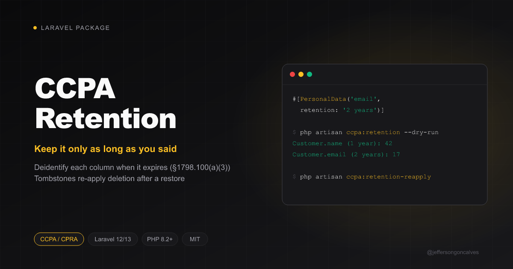

# Laravel CCPA Retention



[](https://packagist.org/packages/jeffersongoncalves/laravel-ccpa-retention)
[](https://github.com/jeffersongoncalves/laravel-ccpa-retention/actions/workflows/tests.yml)
[](https://packagist.org/packages/jeffersongoncalves/laravel-ccpa-retention)

Under the California Consumer Privacy Act, as amended by the CPRA, a business must disclose how long it keeps each category of personal information, and may not keep it longer than reasonably necessary for the disclosed purpose (Cal. Civ. Code §1798.100(a)(3)). This package reads the `retention` you declared with [laravel-ccpa](https://github.com/jeffersongoncalves/laravel-ccpa)'s `#[PersonalData]`. When a column's period ends, it anonymizes that column, using the column's own strategy.

- **Per column:** each column has its own period. `name` can expire after 1 year while `email` lasts 2.
- **`Keep` columns are nullified when their retention ends.** `Keep` only protects a column from deletion requested by the consumer while a legal duty to store it lasts (a §1798.105(d) exception). Once the retention period is over, that duty is over too.
- **Tombstones:** the package records which column of which record it anonymized, without storing any personal data. Because of that, nothing is anonymized twice (a hash is never hashed again). And after you restore a backup, `ccpa:retention-reapply` erases the data that came back.

> This package gives you tooling. It does not make you compliant on its own. Retention periods need legal review.

## Installation

```bash
composer require jeffersongoncalves/laravel-ccpa-retention
php artisan vendor:publish --tag="ccpa-retention-migrations"
php artisan migrate
```

## Declaring retention

```php
#[PersonalData('name', retention: '1 year', anonymize: AnonymizeStrategy::Mask)]
#[PersonalData('email', retention: '2 years', anonymize: AnonymizeStrategy::Hash)]
#[PersonalData('tax_id', retention: '5 years', anonymize: AnonymizeStrategy::Keep)] // nullified after 5 years
#[PersonalData('notes')]                                                           // no retention: never expires
class Customer extends Model implements HasPersonalData
{
    use InteractsWithPersonalData;
}
```

The period accepts any [CarbonInterval](https://carbon.nesbot.com/docs/#api-interval) string (`'90 days'`, `'5 years'`, ...). It is counted from `created_at`. To count it from another date, implement `HasRetentionStart`. Rows where that date is `null` never expire.

```php
use JeffersonGoncalves\CcpaRetention\Contracts\HasRetentionStart;

class Contract extends Model implements HasPersonalData, HasRetentionStart
{
    public static function retentionStartColumn(): string
    {
        return 'ended_at'; // counts from the end of the contract
    }
}
```

## Usage

```bash
php artisan ccpa:retention --dry-run   # what would be anonymized
php artisan ccpa:retention             # anonymize expired columns
php artisan ccpa:retention-reapply     # after restoring a backup
```

```php
// routes/console.php
Schedule::command('ccpa:retention')->daily();
```

### Deletion requested by the consumer

A model may be anonymized outside this package, for example by [laravel-ccpa-requests](https://github.com/jeffersongoncalves/laravel-ccpa-requests)'s `erase()` or by calling `$model->anonymizePersonalData()` directly. Those columns get tombstones too, so `ccpa:retention-reapply` also erases them when a backup brings them back. The listener for laravel-ccpa's `PersonalDataAnonymized` event records them, and you don't need to configure anything. The consumer deletion request skips `Keep` columns, so they get no tombstone, and they are still nullified when their own retention ends.

You can also call it from code: `CcpaRetention::apply(dryRun: false)` returns one row per model and column with the number of records it anonymized. `CcpaRetention::reapply()` returns how many columns it erased again.

## Upgrading to 2.0

2.0 runs on [laravel-privacy](https://github.com/jeffersongoncalves/laravel-privacy), the engine shared by the
LGPD, GDPR, CCPA, US privacy and Quebec suites. The classes, config keys, tables, commands and events of this package
keep their names: your code, config and data need no change. Suites installed side by side never see each other's
events. If you extend a class of this package, it now inherits from its `JeffersonGoncalves\Privacy` base.

## Testing

```bash
composer test
```

## Changelog

See [CHANGELOG](CHANGELOG.md).

## License

The MIT License (MIT). See [License File](LICENSE.md).
